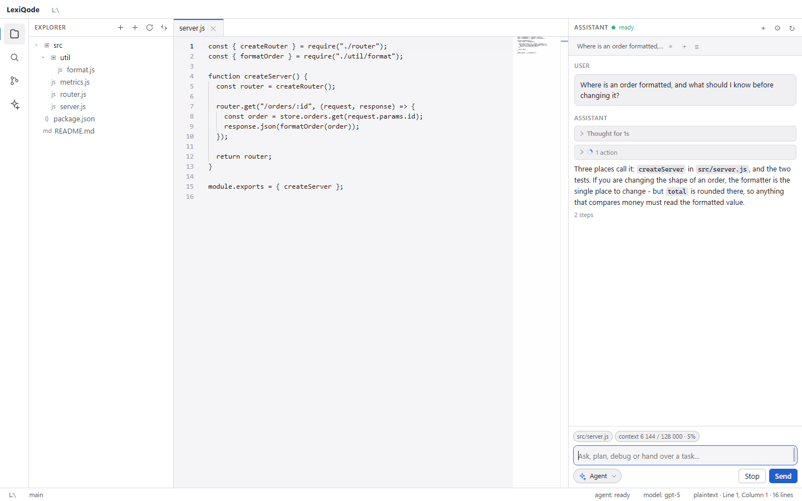

# LexiQode


A Windows IDE with a built-in AI assistant that runs on **your own** model
endpoint: any server compatible with the OpenAI `/chat/completions` API, such as a
hosted gateway, a local runtime (Ollama, LM Studio and similar), or your own
proxy.

There is no subscription, no account and no vendor relay: the endpoint and the key
are stored on the local machine, and the assistant contacts nothing but the address
you configure.

[Русская версия](README.md)

## What it looks like

Every picture below is the application itself: `app/scripts/capture-screenshots.cjs`
starts the window, opens a demonstration project in a temporary folder and captures
the screen over DevTools, so no personal path and no key appears in any of them.



*The assistant: reasoning folded into a line above the answer, the tools of the turn
on one line, and how much of the model's window is in use under the composer.*

| | |
|---|---|
|  |  |
| Explorer and editor | Find in files, with results as they arrive |
|  |  |
| Git: changes, diff, commit | Right-click on a file |
|  |  |
| A real PowerShell in the bottom panel | Settings: endpoint, model, context window, theme |

## Features

| Area | What it does |
|---|---|
| Editor | Monaco: syntax highlighting, tabs, unsaved-change marker, find in file, line endings preserved as they were |
| Explorer | file tree that follows the disk by itself, right-click menu on a file and on a folder, create, rename, delete to the recycle bin, reveal in Explorer, copy path |
| Navigation | go to file with `Ctrl+P` using fuzzy matching, command palette |
| Search | find in files with streaming results and cancellation |
| Source control | git: staged and unstaged separated, diffs, stage, unstage, discard, commit, branch switching |
| Terminal | a real PowerShell session in the bottom panel, colours, working directory preserved |
| Assistant | streaming answers, reasoning folded into a "Thinking…" line above the answer, one line of tools per turn (arguments and results one click away), a context gauge and automatic compaction, approvals, cancel |
| Chats | every conversation is saved on disk on its own and opens in a tab: a new chat does not erase the previous one, a saved chat can be reopened from the list, and each can be renamed or deleted |
| Modes | Agent, Ask, Plan, Debug, Review - what the next message is allowed to do |
| Interface | resizable and restorable layout, dark and light themes (from the settings and the command palette), Russian and English |

## Requirements

* Windows 10 or 11, 64-bit.
* Python 3.11 or newer on `PATH` for the assistant. The editor works without it,
  and the application says so.
* Node.js 24, only to build from source.
* No administrator rights.

## Installation

1. Download `LexiQode-<version>-win32-x64.zip` from the
   [Releases](../../releases) page.
2. Unpack it into any folder.
3. Run `LexiQode.exe`.

Nothing is installed into the system. A `.sha256` file sits beside the archive; the
download can be verified with:

```powershell
Get-FileHash .\LexiQode-0.2.0-win32-x64.zip -Algorithm SHA256
```

## First run

The application does not open a folder by itself. It shows a screen with an *Open a
folder* button and the list of recent folders. A folder can also be opened:

* by clicking the "no folder open" item in the status bar;
* with `Ctrl+K Ctrl+O`;
* through the command palette: `Ctrl+Shift+P` → *Open folder…*;
* by passing a path at launch: `LexiQode.exe D:\projects\example` (an absolute
  path).

Without an open folder the assistant does not start, because it works inside one.

## Configuring a model

The assistant panel opens with `Ctrl+Shift+A`; its settings are behind the gear
button in its header.

| Field | Value |
|---|---|
| endpoint | base URL: `https://api.example.com/v1`, `http://127.0.0.1:11434/v1` |
| api key | stored locally, sent only to that endpoint |
| model | the model id; the list is filled in automatically |
| context window | how many tokens the model accepts in one request (128 000 by default) |
| max output | how many tokens one answer may occupy (8 192 by default) |
| compact at, % | share of the window after which the oldest messages are replaced by a summary (75 by default) |

The model list is requested as soon as the endpoint and the key are entered; there
is nothing to save first. The request goes to `GET {endpoint}/models`, so the base
URL has to be the one that makes that path correct. If the server is unreachable or
the list is empty, the form shows why and offers to try again.

Above the input the panel shows how much of the context is in use: `context 12 480 /
128 000 · 10%`. Either the server reported that number or the core estimated it from
the length of the conversation - the tooltip says which. When the conversation
approaches the limit (75% of the window by default) the core asks the model to
compress the oldest part and replaces it with a summary; a "Context compacted" line
appears in the transcript. That summary is kept through later compactions, so
decisions and paths are not lost; if the summary call fails, the old part is dropped
with a note saying what was lost.

## Conversations

Every chat is saved on disk as a file of its own and opens in a tab above the
transcript. A new chat (the `+` button, or "New conversation") opens another tab
and leaves the previous one alone; the "≡" button lists the saved chats, and any
of them can be brought back into a tab, renamed (right-click a tab) or deleted.
The open tabs are restored on the next start, and the conversations themselves
live in `%LOCALAPPDATA%\LexiQode\conversations\<folder>\` - one file per chat, so
switching folders never mixes two projects up.

The same settings can be configured without the graphical interface:

```powershell
$env:LEXIQODE_BASE_URL = 'https://api.example.com/v1'
$env:LEXIQODE_API_KEY  = 'sk-...'
$env:LEXIQODE_MODEL    = 'your-model'
python -m lexiqode doctor     # checks the endpoint, the key and the model
```

State files:

| Path | Contents |
|---|---|
| `%APPDATA%\LexiQode\settings.json` | the agent: endpoint, key, model, limits |
| `%APPDATA%\LexiQode\app-settings.json` | the window: layout, theme, language, tabs |
| `%LOCALAPPDATA%\LexiQode` | transcripts and other per-machine data |

## Modes

The mode is chosen in the composer of the assistant panel, from a dropdown with
icons. It is the decision about what the next message may do.

| Mode | Reads files | Modifies files | Runs commands |
|---|---|---|---|
| Agent | yes | yes | yes |
| Ask | yes | no | no |
| Plan | yes | no | no |
| Debug | yes | yes | yes |
| Review | yes | no | no |

Modes are enforced in the core rather than only displayed: a forbidden tool is
removed from the schemas and refused by the tool registry.

## Keyboard

| Keys | Action |
|---|---|
| `Ctrl+P` | go to a file |
| `Ctrl+Shift+P` | command palette |
| `Ctrl+S` / `Ctrl+Shift+S` | save the file / all files |
| `Ctrl+Shift+F` | find in files |
| `Ctrl+B` | sidebar |
| `Ctrl+J` | bottom panel (terminal) |
| `Ctrl+Shift+A` | assistant panel |
| `Ctrl+L` | focus the assistant input |
| `Ctrl+Shift+E` / `Ctrl+Shift+G` | explorer / source control |
| `Ctrl+K Ctrl+O` | open a folder |
| `Esc` | close a list or the palette |

## Interface language

Switch it with the "window language" row in the assistant settings, or with the
"Window language: change" command in the palette: follow the system → Russian →
English. By default the system language is used.

Dictionaries are data files, `app/src/shared/i18n.ru.json` and
`app/src/shared/i18n.en.json`. Adding a language means adding such a file and its
code in `app/src/shared/i18n.js`; a test compares the key sets of the dictionaries
and refuses to let them drift apart.

## Limitations

* **The terminal is a command console.** The shell is connected through pipes and
  there is no pseudo-console, so full-screen programs (`vim`, `top`) do not work in
  it. Everything that reads a command and prints lines does work.
* **No third-party extensions.** Languages, themes and commands are provided by the
  application itself.
* **Language support comes from Monaco:** real language services for TypeScript,
  JavaScript, JSON, CSS and HTML, and syntax highlighting, bracket matching and
  folding for everything else.
* **One folder per window.**
* **No telemetry.** The window has no network access at all; only the core uses the
  network, and only to reach the endpoint you configured.
* Messages that originate in the core are printed as the core phrased them.
* Only Windows is supported.

## Building from source

```powershell
git clone https://github.com/KentoGasai/LexiQode2.git
cd LexiQode2\app
npm install
node node_modules\electron\install.js
cd ..
powershell -ExecutionPolicy Bypass -File scripts\build-app.ps1
```

The script runs the tests, stages a portable folder and writes an archive with its
digest into `dist\`. The version comes from `app/package.json`. `-SkipTests` skips
the tests; `scripts\run-app.ps1 -Source` runs the application from the sources
without building.

Publishing a build is a matter of attaching the archive to a GitHub release:

```powershell
gh release create v0.2.0 `
  dist\LexiQode-0.2.0-win32-x64.zip `
  dist\LexiQode-0.2.0-win32-x64.zip.sha256 `
  --title "LexiQode 0.2.0" --notes-file docs\release-notes\v0.2.0.md
```

## Tests

```powershell
pip install -r core\requirements.txt pytest
cd core;  python -m pytest tests -q
cd app;   npm test
```

Six scripts start the application and interrogate it from outside. All of them run
with an isolated configuration, so they can be started while the application is
open and never touch your own files:

| Script | What it checks |
|---|---|
| `probe-window.cjs` | the whole window: tree, editor, search, terminal, model list |
| `probe-interactions.cjs` | the panels with no folder open, dragging boundaries, saving by keyboard |
| `probe-chat-window.cjs` | the assistant through the window: settings, model choice, an answer, reasoning, tools, chat tabs |
| `probe-explorer-live.cjs` | the tree follows the disk; right-click on a file and on empty space |
| `probe-chat.cjs` | the core end to end, through a stub OpenAI-compatible server |
| `capture-screenshots.cjs` | takes the screenshots for this README (above) |

## Repository layout

```
app/                  the application
  src/main/           Electron process: window, IPC, workspace, search, git, terminal, agent link
  src/preload/        the only set of calls the page may make
  src/renderer/       the interface: markup, styles, modules
  src/shared/         logic shared by both sides, and the language dictionaries
  test/               tests
core/                 the Python agent, with its own tests
scripts/              build, run, shortcuts
docs/protocol.md      the protocol between the window and the core
docs/screenshots/     the pictures in this README, captured from a running window
ROADMAP.md            where this goes: MCP, Skills, subagents, 1.0
CHANGELOG.md          what each release contains
```

## Licence and feedback

Released under the [MIT licence](LICENSE). The build uses Monaco (MIT) and xterm.js
(MIT).

Bug reports and suggestions are welcome in
[Issues](../../issues). Pull requests are welcome too; running both test suites
before sending one is appreciated, and the commands are above.