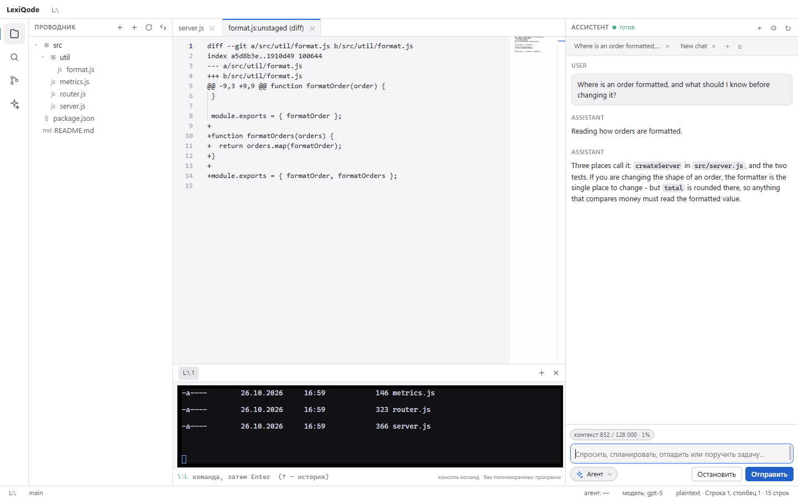
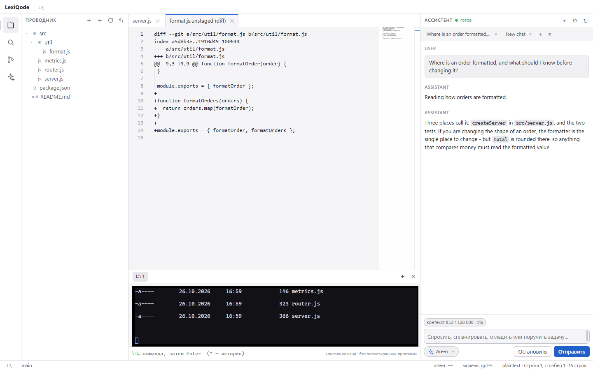
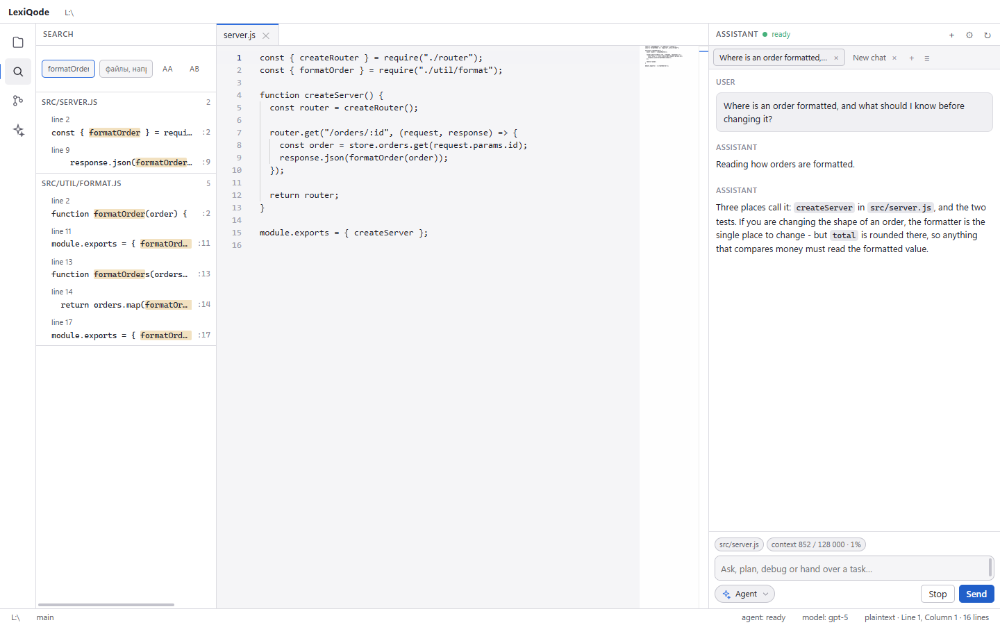
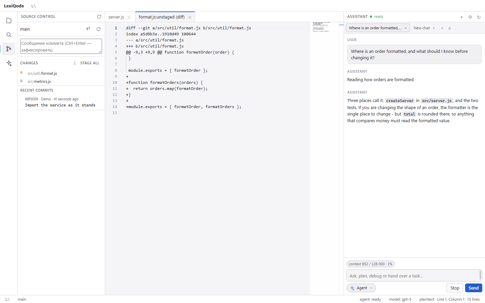
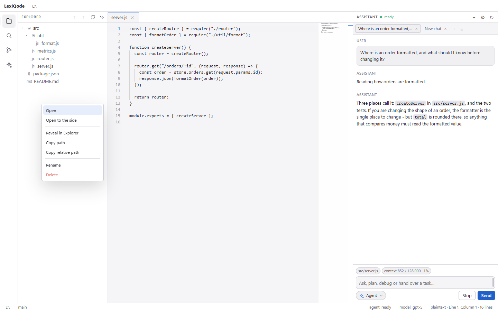
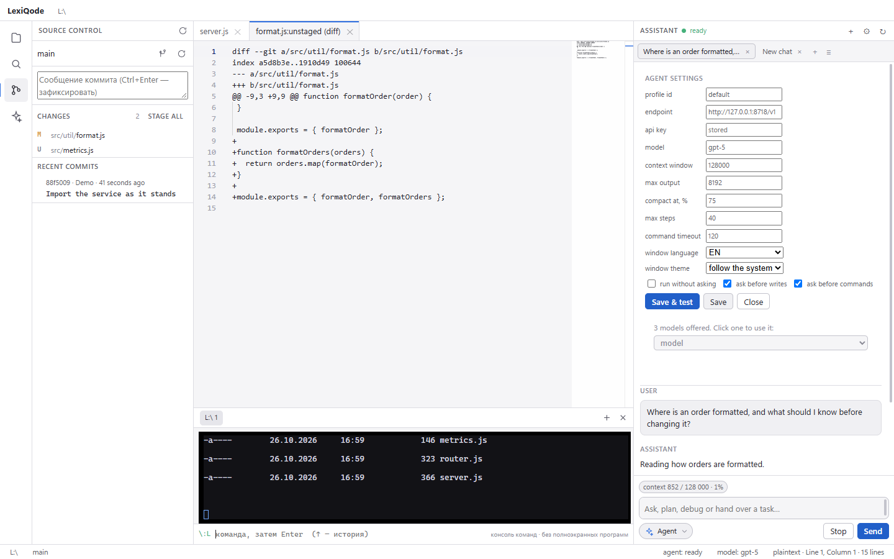

# LexiQode


IDE для Windows со встроенным ИИ-ассистентом, который работает на **своём** адресе
модели — подойдёт любой сервер, совместимый с OpenAI `/chat/completions`:
облачный шлюз, локальный рантайм (Ollama, LM Studio и подобные) или собственный
прокси.

Подписки, учётной записи и посредников нет: адрес и ключ хранятся на машине
пользователя, ассистент обращается только к указанному адресу.

[English version](README.en.md)

## Как это выглядит

Снимки сделаны с самого приложения: скрипт `app/scripts/capture-screenshots.cjs`
запускает окно, открывает демонстрационный проект во временной папке и снимает
экран через DevTools — на них нет ни чужих путей, ни ключей.



*Ассистент: рассуждения свёрнуты в строку над ответом, инструменты — одной строкой
на ход, под полем ввода видно, сколько занято из окна модели.*

| | |
|---|---|
|  |  |
| Проводник и редактор | Поиск по всем файлам с результатами по мере поступления |
|  |  |
| Git: изменения, diff, коммит | Правый клик по файлу |
|  |  |
| Настоящий PowerShell в нижней панели | Настройки: адрес, модель, окно контекста, тема |

## Возможности

| Раздел | Что умеет |
|---|---|
| Редактор | Monaco: подсветка, вкладки, признак несохранённых правок, поиск в файле, переводы строк сохраняются как были |
| Проводник | дерево файлов, обновляется само при изменениях на диске, контекстное меню на файл и папку, добавление файла в контекст ассистента, создание, переименование, удаление в корзину, показ в проводнике, копирование пути |
| Навигация | переход к файлу по `Ctrl+P` с нечётким поиском, палитра команд |
| Поиск | поиск по всем файлам с результатами по мере поступления и возможностью отмены |
| Контроль версий | git: подготовленное и изменённое раздельно, diff, подготовка, снятие, отмена, коммит, переключение ветки |
| Терминал | настоящая сессия PowerShell в нижней панели, цвета, сохранение текущего каталога; при открытии папки открывается сама и уже в этой папке |
| Ассистент | выбор модели рядом с кнопкой режима, потоковый ответ, рассуждения свёрнуты в строку «Думаю…» над ответом, вызовы инструментов одной строкой на ход (с аргументами и результатом по нажатию), счётчик контекста и автоматическое сжатие, подтверждения, остановка |
| Чаты | каждый разговор сохраняется на диск отдельно и открывается вкладкой: новый чат не стирает предыдущий, список сохранённых открывается вкладкой заново, переименование и удаление |
| Режимы работы | Agent, Ask, Plan, Debug, Review — что именно разрешено следующему сообщению |
| Интерфейс | изменяемая и восстанавливаемая раскладка, тёмная и светлая темы (кнопка в левом нижнем углу, палитра команд, настройки), русский и английский языки |
| Настройки | окно `Ctrl+,`: оформление, редактор, раскладка, файлы, терминал, поведение ассистента, обновления, версия |
| Обновления | проверка новых выпусков на GitHub при запуске и по команде, скачивание архива и установка на место текущей версии |
| Контекст сообщения | каждый файл, который уйдёт со следующим сообщением, — чип с крестиком; файл можно добавить из дерева или открытым файлом, а можно убрать и вернуть |

## Требования

* Windows 10 или 11, 64-бит.
* Python 3.11 или новее в `PATH` — нужен ассистенту. Без него работает редактор,
  а приложение сообщает, чего не хватает.
* Node.js 24 — только для сборки из исходников.
* Права администратора не требуются.

## Установка

1. Скачайте архив `LexiQode-<версия>-win32-x64.zip` со страницы
   [Releases](../../releases).
2. Распакуйте его в любую папку.
3. Запустите `LexiQode.exe`.

Приложение не устанавливается в систему и не требует прав администратора.
Рядом с архивом лежит файл `.sha256`; при желании целостность можно проверить:

```powershell
Get-FileHash .\LexiQode-0.2.0-win32-x64.zip -Algorithm SHA256
```

## Первый запуск

Приложение не открывает папку само — оно показывает экран с кнопкой «Открыть
папку» и списком недавних. Открыть папку можно также:

* щёлкнув по надписи «папка не открыта» в строке состояния;
* сочетанием `Ctrl+K Ctrl+O`;
* через палитру команд: `Ctrl+Shift+P` → «Открыть папку…»;
* передав путь при запуске: `LexiQode.exe D:\projects\example` (нужен абсолютный
  путь).

Без открытой папки ассистент не запускается: он работает внутри неё.

## Настройка модели

Панель ассистента открывается сочетанием `Ctrl+Shift+A`, настройки — кнопкой с
шестерёнкой в её заголовке.

| Поле | Значение |
|---|---|
| адрес | базовый URL: `https://api.example.com/v1`, `http://127.0.0.1:11434/v1` |
| ключ API | хранится локально и отправляется только на этот адрес |
| модель | идентификатор модели; список подставляется автоматически |
| окно контекста | сколько токенов принимает модель за один запрос (по умолчанию 128 000) |
| ответ не более | сколько токенов может занимать один ответ (по умолчанию 8 192) |
| сжимать при, % | доля окна, после которой старые сообщения заменяются сводкой (по умолчанию 75) |

Список моделей запрашивается сразу после ввода адреса и ключа, сохранять заранее
ничего не нужно. Запрос идёт по адресу `GET {адрес}/models`, поэтому базовый адрес
должен быть таким, чтобы этот путь получался правильным. Если сервер недоступен
или список пуст, форма показывает причину и предлагает повторить запрос.

Над полем ввода панель показывает, сколько контекста занято: `контекст 12 480 /
128 000 · 10%`. Это число либо сообщает сервер, либо считает ядро по длине
разговора — в подсказке написано, что именно. Когда разговор подходит к пределу
(по умолчанию 75% окна), ядро просит модель сжать старую часть разговора и
заменяет её сводкой, а в ленте появляется строка «Контекст сжат». Сводка
сохраняется при следующем сжатии, поэтому решения и пути не теряются; если сжать
не удалось, старая часть отбрасывается с пометкой, что именно потеряно.

## Разговоры

Каждый чат сохраняется на диск отдельным файлом и открывается вкладкой над лентой.
Новый чат (`+` или «Новый разговор») открывает ещё одну вкладку и не трогает
предыдущую; список сохранённых чатов открывается кнопкой «≡» — любой из них можно
вернуть во вкладку, переименовать (правый клик по вкладке) или удалить. Вкладки
восстанавливаются при следующем запуске, а сами разговоры лежат в
`%LOCALAPPDATA%\LexiQode\conversations\<папка>\` — по файлу на чат, так что
переключение папки не смешивает проекты.

Те же настройки доступны без графического интерфейса:

```powershell
$env:LEXIQODE_BASE_URL = 'https://api.example.com/v1'
$env:LEXIQODE_API_KEY  = 'sk-...'
$env:LEXIQODE_MODEL    = 'имя-модели'
python -m lexiqode doctor     # проверяет адрес, ключ и модель
```

Файлы состояния:

| Путь | Содержимое |
|---|---|
| `%APPDATA%\LexiQode\settings.json` | агент: адрес, ключ, модель, лимиты |
| `%APPDATA%\LexiQode\app-settings.json` | окно: раскладка, тема, язык, вкладки |
| `%LOCALAPPDATA%\LexiQode` | история разговоров и прочие данные |

## Режимы работы

Режим выбирается в композере панели ассистента — выпадающим списком с иконками.
Это решение о том, что разрешено следующему сообщению.

| Режим | Читает файлы | Изменяет файлы | Запускает команды |
|---|---|---|---|
| Agent | да | да | да |
| Ask | да | нет | нет |
| Plan | да | нет | нет |
| Debug | да | да | да |
| Review | да | нет | нет |

Режимы проверяются в ядре, а не только отображаются: запрещённый инструмент
убирается из схем и отклоняется реестром инструментов.

## Горячие клавиши

| Клавиши | Действие |
|---|---|
| `Ctrl+P` | перейти к файлу |
| `Ctrl+Shift+P` | палитра команд |
| `Ctrl+S` / `Ctrl+Shift+S` | сохранить файл / все файлы |
| `Ctrl+Shift+F` | поиск по всем файлам |
| `Ctrl+B` | боковая панель |
| `Ctrl+J` | нижняя панель (терминал) |
| `Ctrl+Shift+A` | панель ассистента |
| `Ctrl+L` | переход к полю ввода ассистента |
| `Ctrl+Shift+E` / `Ctrl+Shift+G` | проводник / контроль версий |
| `Ctrl+K Ctrl+O` | открыть папку |
| `Ctrl+,` | настройки приложения |
| `Esc` | закрыть список или палитру |

## Настройки и обновления

Настройки окна открываются по `Ctrl+,`, из меню «Файл ▸ Настройки…» и из палитры
команд. Всё, что в них меняется, применяется сразу: запись идёт через тот же файл
настроек, из которого окно читает, поэтому форма не становится вторым источником
правды. Настройки агента (адрес, ключ, модель, лимиты) остались в отдельной форме
панели ассистента.

Кнопка темы — в левом нижнем углу строки состояния: она перебирает тёмную,
светлую и «как в системе» и подписывает, что сделает следующий щелчок.

Обновления берутся из Releases на GitHub: при запуске (если включено) и по команде
«Справка ▸ Проверить обновления…». Если выпуск новее, окно предлагает скачать
архив; после скачивания — «Закрыть и установить». Сама установка сделана так,
чтобы не воевать с работающим приложением:

1. архив скачивается в `%APPDATA%\LexiQode\updates` и распаковывается целиком;
2. приложение закрывается;
3. отдельный скрипт `apply-update.ps1` дожидается исчезновения процесса,
   отставляет текущую папку в сторону, распаковывает новую версию на то же место,
   запускает её и удаляет старую;
4. если что-то не удалось, старая версия возвращается на место и запускается —
   приложение не остаётся наполовину заменённым. Ход установки пишется в
   `%APPDATA%\LexiQode\updates\update.log`.

Настройки и данные при этом не трогаются: они лежат вне папки приложения. Сборка,
запущенная из исходников, заменять себя отказывается — для неё есть страница
выпуска.

## Язык интерфейса

Переключается строкой «язык окна» в настройках ассистента или командой «Язык
окна: изменить» в палитре: «как в системе» → русский → английский. По умолчанию
язык берётся у системы.

Словари — это файлы данных `app/src/shared/i18n.ru.json` и
`app/src/shared/i18n.en.json`. Чтобы добавить язык, достаточно положить такой же
файл и добавить его код в `app/src/shared/i18n.js`; тест сверяет наборы ключей и
не даст словарям разойтись.

## Ограничения

* **Терминал является консолью команд.** Оболочка подключена через каналы
  ввода-вывода, псевдоконсоли нет, поэтому полноэкранные программы (`vim`, `top`)
  в нём не работают. Всё, что читает команду и печатает строки, работает.
* **Сторонних расширений нет.** Языки, темы и команды предоставляет само
  приложение.
* **Языковая поддержка зависит от Monaco:** настоящие языковые службы доступны
  для TypeScript, JavaScript, JSON, CSS и HTML, для остальных языков — подсветка,
  парные скобки и сворачивание.
* **Одна папка на окно.**
* **Телеметрии нет.** Само окно доступа в сеть не имеет: страница не может
  обратиться никуда. Сеть используют только ядро (к указанному адресу модели) и
  проверка обновлений — она запрашивает Releases на GitHub из главного процесса,
  и её можно выключить в настройках.
* **Обновление заменяет папку приложения.** Портативная сборка обновляется на
  месте: архив распаковывается вместо текущей папки отдельным скриптом, который
  запускается после закрытия приложения. Файлы, которые вы положили в папку
  приложения сами, там не сохранятся; настройки и данные лежат вне неё.
* **Запуск из исходников не обновляется сам.** Такой сборке предлагается страница
  выпуска: заменять репозиторий, из которого её запустили, было бы странно.
* Сообщения, приходящие из ядра, выводятся так, как их сформулировало ядро.
* Поддерживается только Windows.

## Сборка из исходников

```powershell
git clone https://github.com/KentoGasai/LexiQode.git
cd LexiQode\app
npm install
node node_modules\electron\install.js
cd ..
powershell -ExecutionPolicy Bypass -File scripts\build-app.ps1
```

Скрипт прогоняет тесты, собирает переносимую папку и архив с контрольной суммой в
`dist\`. Версия берётся из `app/package.json`. Флаг `-SkipTests` пропускает тесты,
`scripts\run-app.ps1 -Source` запускает приложение из исходников без сборки.

Публикация сборки — обычным прикреплением архива к релизу GitHub:

```powershell
gh release create v0.2.0 `
  dist\LexiQode-0.2.0-win32-x64.zip `
  dist\LexiQode-0.2.0-win32-x64.zip.sha256 `
  --title "LexiQode 0.2.0" --notes-file docs\release-notes\v0.2.0.md
```

## Тесты

```powershell
pip install -r core\requirements.txt pytest
cd core;  python -m pytest tests -q
cd app;   npm test
```

Восемь замеров запускают приложение и опрашивают его снаружи, все — с
изолированными настройками, так что их можно запускать при открытом приложении и
они не касаются ваших файлов:

| Скрипт | Что проверяет |
|---|---|
| `probe-window.cjs` | окно целиком: дерево, редактор, поиск, терминал, список моделей |
| `probe-interactions.cjs` | панели без папки, перетаскивание границ, сохранение по сочетанию клавиш |
| `probe-chat-window.cjs` | ассистент через окно: настройка, выбор модели, ответ, рассуждения, инструменты, вкладки чатов |
| `probe-explorer-live.cjs` | дерево обновляется при изменениях на диске; правый клик по файлу и по пустому месту |
| `probe-editor-colors.cjs` | файлы семи видов открываются своим языком и с подсветкой: сверяет id языка и число цветов токенов |
| `probe-app-features.cjs` | оболочка открывается вместе с папкой, модель рядом с режимом, файл убирается из сообщения и возвращается, кнопка темы, окно настроек и запись настройки, состояние проверки обновлений |
| `probe-chat.cjs` | ядро целиком через заглушку OpenAI-совместимого сервера |
| `capture-screenshots.cjs` | снимает скриншоты для README (см. выше) |

## Устройство репозитория

```
app/                  приложение
  src/main/           процесс Electron: окно, IPC, рабочая папка, поиск, git, терминал, связь с ядром
  src/preload/        единственный набор вызовов, доступных странице
  src/renderer/       интерфейс: разметка, стили, модули
  src/shared/         логика, общая для обеих сторон, и словари языков
  test/               тесты
core/                 агент на Python со своими тестами
scripts/              сборка, запуск, ярлыки
docs/protocol.md      протокол между окном и ядром
docs/screenshots/     снимки для README, снятые на живом окне
ROADMAP.md            куда проект идёт: MCP, Skills, подагенты, 1.0
CHANGELOG.md          что вошло в каждый выпуск
```

## Лицензия и обратная связь

Проект распространяется по лицензии [MIT](LICENSE). В сборке используются Monaco
(MIT) и xterm.js (MIT).

Сообщения об ошибках и предложения — через [Issues](../../issues), планы — в
[ROADMAP.md](ROADMAP.md), история выпусков — в [CHANGELOG.md](CHANGELOG.md).
Пул-реквесты приветствуются; перед отправкой стоит прогнать оба набора тестов,
команды приведены выше.